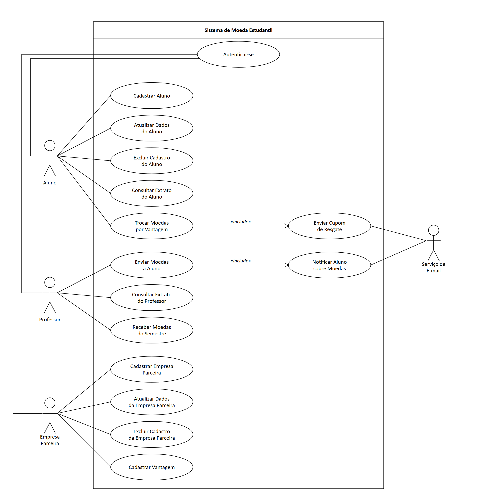
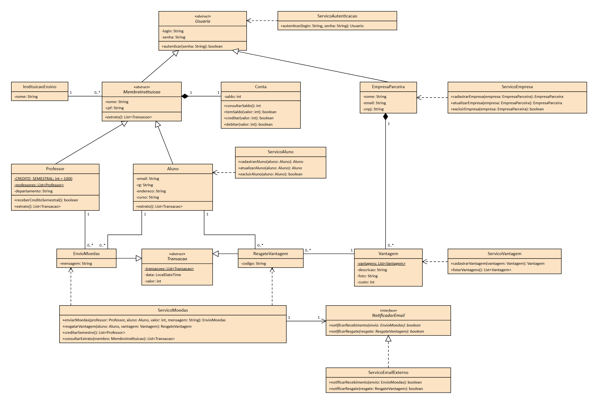
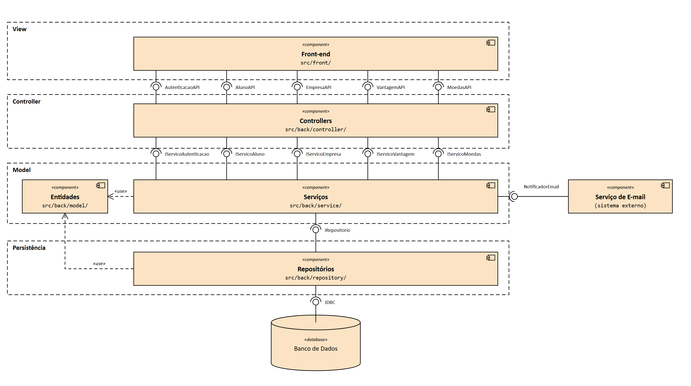

# Sistema de Moeda Estudantil

Trabalho da disciplina Projeto de Software. O projeto consiste em modelar e
implementar um sistema de moeda virtual para reconhecer o mérito dos estudantes,
dividido em sprints semanais.

## Integrantes

- Lucas Lima Magalhães Lafetá Chaves

## Descrição do sistema

O sistema estimula o reconhecimento do mérito estudantil por meio de uma moeda
virtual. Os professores distribuem moedas aos seus alunos, por exemplo por bom
comportamento ou participação em aula, e os alunos trocam essas moedas por
produtos e descontos oferecidos por empresas parceiras.

O aluno se cadastra informando nome, e-mail, CPF, RG, endereço, instituição de
ensino e curso. As instituições participantes e os professores (nome, CPF e
departamento) já vêm pré-cadastrados. A cada semestre cada professor recebe mil
moedas, e o que não for distribuído se acumula no saldo. Para enviar moedas, o
professor precisa de saldo suficiente e deve informar o aluno e o motivo do
reconhecimento. O aluno é avisado por e-mail ao receber moedas.

Professores e alunos consultam o extrato da conta, com o saldo e as transações
(envios, no caso do professor; recebimentos e trocas, no caso do aluno). As
empresas parceiras se cadastram e oferecem vantagens, cada uma com descrição,
foto e custo em moedas. Ao trocar moedas por uma vantagem, o valor é descontado
do saldo do aluno e um e-mail com um código de cupom é enviado ao aluno e à
empresa, para conferir a troca. Todos os usuários acessam o sistema com login e
senha.

## Diagrama de Caso de Uso

### Atores

- **Aluno**: participa do sistema de mérito, recebe moedas e as troca por vantagens.
- **Professor**: distribui moedas aos alunos e recebe 1.000 moedas por semestre.
- **Empresa Parceira**: cadastra as vantagens que oferece em troca de moedas.
- **Serviço de E-mail** (sistema externo): envia as notificações e os cupons por e-mail.

## Histórias de Usuário

### Todos os perfis

#### Autenticar-se

> **Como** aluno, professor ou empresa parceira, **quero** entrar no sistema com meu login e senha, **para** acessar as funcionalidades do meu perfil.

- Alunos, professores e empresas parceiras têm login e senha cadastrados.
- As funcionalidades de cada perfil só são acessíveis após a autenticação.
- O cadastro inicial de aluno e de empresa parceira é feito antes de existir um login.

### Aluno

#### Cadastrar aluno

> **Como** aluno, **quero** me cadastrar no sistema de mérito, **para** receber moedas dos meus professores e trocá-las por vantagens.

- O aluno informa nome, e-mail, CPF, RG, endereço, curso, login e senha.
- A instituição de ensino é escolhida entre as instituições já pré-cadastradas.

#### Atualizar dados do aluno

> **Como** aluno, **quero** atualizar meus dados cadastrais, **para** mantê-los corretos.

- Só o próprio aluno autenticado altera os seus dados.

#### Excluir cadastro do aluno

> **Como** aluno, **quero** excluir meu cadastro, **para** deixar de participar do sistema de mérito.

- Só o próprio aluno autenticado exclui o seu cadastro.

#### Consultar extrato do aluno

> **Como** aluno, **quero** consultar o extrato da minha conta, **para** acompanhar meu saldo e minhas movimentações.

- O extrato mostra o total de moedas que o aluno ainda possui.
- O extrato lista os recebimentos de moedas e as trocas por vantagens.

#### Trocar moedas por vantagem

> **Como** aluno, **quero** trocar minhas moedas por uma vantagem cadastrada, **para** aproveitar o reconhecimento que recebi.

- O aluno seleciona uma das vantagens cadastradas no sistema.
- O saldo do aluno precisa cobrir o custo da vantagem, e o valor é descontado do saldo.
- O sistema gera um código para a troca.
- Um e-mail de cupom, com o código, é enviado ao aluno para a troca presencial.
- Um e-mail, com o mesmo código, é enviado à empresa parceira para conferir a troca.

### Professor

#### Enviar moedas a um aluno

> **Como** professor, **quero** enviar moedas a um aluno, **para** reconhecer seu bom comportamento ou sua participação em aula.

- O professor precisa ter saldo suficiente para o montante enviado.
- O professor indica o aluno que recebe as moedas.
- O motivo do reconhecimento é uma mensagem aberta e obrigatória.
- O aluno é notificado por e-mail ao receber as moedas.

#### Consultar extrato do professor

> **Como** professor, **quero** consultar o extrato da minha conta, **para** acompanhar meu saldo e as moedas que já enviei.

- O extrato mostra o total de moedas que o professor ainda possui.
- O extrato lista os envios de moedas.

#### Receber moedas do semestre

> **Como** professor, **quero** receber moedas a cada semestre, **para** ter o que distribuir aos meus alunos.

- A cada semestre o sistema credita 1.000 moedas ao professor.
- O total é acumulável: as moedas não distribuídas permanecem no saldo e as 1.000 novas são somadas a ele.

### Empresa Parceira

#### Cadastrar empresa parceira

> **Como** empresa parceira, **quero** me cadastrar no sistema, **para** oferecer vantagens aos alunos.

- A empresa informa nome, e-mail, login e senha.

#### Atualizar dados da empresa parceira

> **Como** empresa parceira, **quero** atualizar meus dados cadastrais, **para** mantê-los corretos.

- Só a própria empresa autenticada altera os seus dados.

#### Excluir cadastro da empresa parceira

> **Como** empresa parceira, **quero** excluir meu cadastro, **para** encerrar a parceria com o sistema.

- Só a própria empresa autenticada exclui o seu cadastro.

#### Cadastrar vantagem

> **Como** empresa parceira, **quero** cadastrar as vantagens que ofereço, **para** que os alunos possam trocá-las por moedas.

- A vantagem tem descrição, foto do produto e custo em moedas.
- A vantagem pertence à empresa que a cadastrou.

### Serviço de e-mail (sistema externo)

#### Notificar aluno sobre moedas recebidas

> **Como** serviço de e-mail, **quero** ser acionado quando um professor envia moedas, **para** avisar o aluno por e-mail.

- O e-mail é enviado ao aluno sempre que ele recebe moedas.

#### Enviar cupom de resgate

> **Como** serviço de e-mail, **quero** ser acionado quando um aluno resgata uma vantagem, **para** enviar o cupom ao aluno e a conferência à empresa parceira.

- O aluno e a empresa parceira recebem, cada um, um e-mail.
- Os dois e-mails incluem o mesmo código gerado pelo sistema.

### Fora do escopo

- Instituições de ensino e professores já vêm pré-cadastrados no sistema, por isso não há história de cadastro para eles.

## Diagrama de Classes

## Diagrama de Componentes

## Entregas por sprint

- **Sprint 1** — diagrama de casos de uso, histórias de usuário, diagrama de classes e
  diagrama de componentes.
- **Sprint 2** — modelo ER, estratégia de acesso ao banco de dados e versão inicial
  dos CRUDs de aluno e empresa parceira.
- **Sprint 3** — versão final dos CRUDs, apresentação da arquitetura e da camada de
  persistência.
